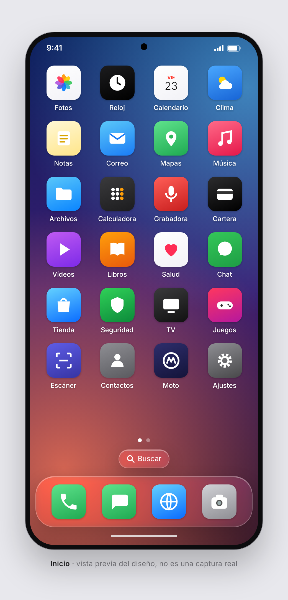
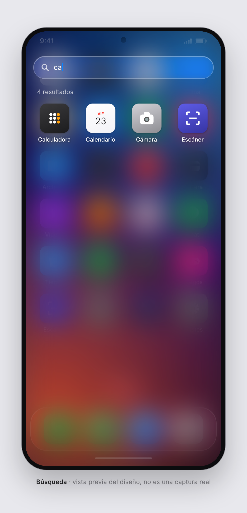
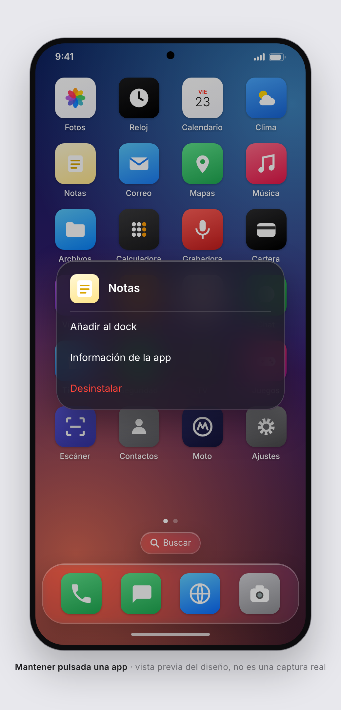
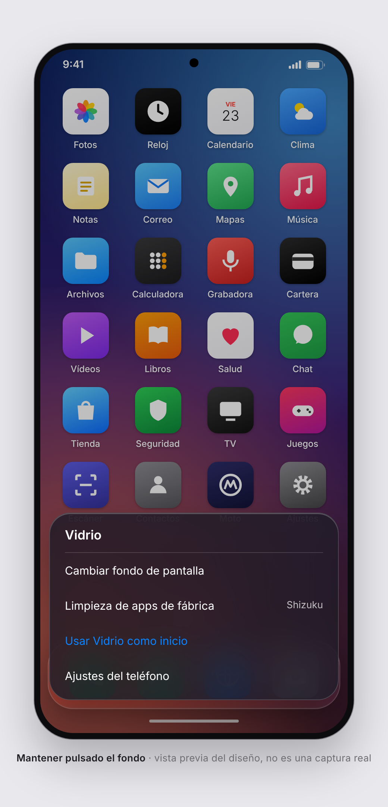
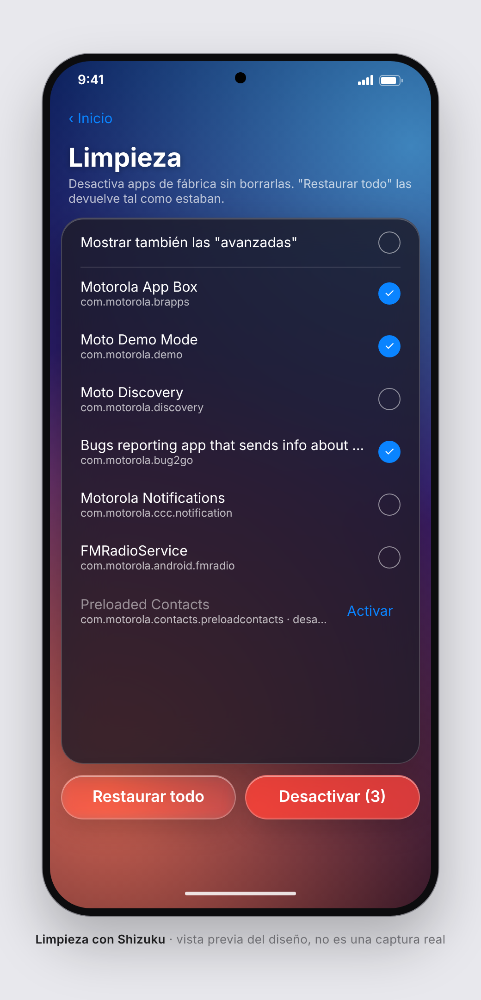

# EdgeOS · Vidrio

**Un launcher para Android con aspecto de iOS 26 ("Liquid Glass") que además limpia las apps de fábrica, sin root y sin PC.**

Pensado para el **Motorola Edge 70 con Android 16**. Funciona en cualquier Android 13 o superior.

[Qué hace](#qué-hace) · [Capturas](#capturas) · [Instalación](docs/INSTALACION.md) · [Volver atrás](#volver-atrás) · [Licencias](#licencias)

> [!IMPORTANT]
> **Versión 0.1, sin compilar todavía.** El código se escribió en un entorno sin acceso al Android SDK, así que
> esta versión **nunca se ha compilado ni probado en un teléfono**. Lo normal es que la primera compilación dé
> algún error pequeño. Si te pasa, abre un *issue* con el mensaje.
>
> Las imágenes de abajo son **maquetas del diseño**, no capturas reales. Se cambiarán por capturas del Edge 70
> en cuanto la app funcione.

## Qué hace

- **Inicio estilo iPhone**: cuadrícula de 4 columnas por páginas, puntos de página, botón **Buscar** sobre el
  dock e iconos en cuadrado redondeado (sin la máscara de cada fabricante).
- **Dock de vidrio** con hasta 4 apps. La primera vez pone el teléfono, los mensajes, el navegador y la cámara.
- **Búsqueda** sin distinguir tildes ni mayúsculas: "camara" encuentra "Cámara".
- **Mantener pulsada una app**: añadirla o quitarla del dock, ver su información, desinstalarla.
- **Mantener pulsado el fondo**: cambiar el fondo de pantalla, ir a Limpieza o hacer de Vidrio el inicio.
- **Limpieza** con [Shizuku](https://shizuku.rikka.app/): desactiva con `pm disable-user` las apps que la lista de
  [UAD-ng](https://github.com/Universal-Debloater-Alliance/universal-android-debloater-next-generation) marca como
  seguras de quitar. **No borra nada**, y *Restaurar todo* las vuelve a activar.

El efecto de vidrio es [Kyant0/AndroidLiquidGlass](https://github.com/Kyant0/AndroidLiquidGlass): desenfoque,
refracción en los bordes y viveza de color, en tiempo real.

## Capturas

Maquetas del diseño hechas con las medidas del código (dp de la app = px de la imagen). No son capturas
de la app en marcha. Los iconos son genéricos, como ejemplo: en tu teléfono se ven los de tus apps.

<table>
  <tr>
    <td align="center"> <b>Inicio</b></td>
    <td align="center"> <b>Búsqueda</b></td>
    <td align="center"> <b>Menú de una app</b></td>
  </tr>
  <tr>
    <td align="center"> <b>Ajustes</b></td>
    <td align="center"> <b>Limpieza</b></td>
    <td></td>
  </tr>
</table>

## Instalación

La guía completa, paso a paso y con solución de problemas, está en **[docs/INSTALACION.md](docs/INSTALACION.md)**.
En resumen:

1. En el móvil, activa las **Opciones de desarrollador** y la **Depuración USB**.
2. En el PC, instala [Android Studio](https://developer.android.com/studio) y abre esta carpeta.
3. Conecta el móvil por USB y pulsa ▶ *Run 'app'* (o `./gradlew installDebug`).
4. En el móvil, abre Vidrio → mantén pulsado el fondo → *Usar Vidrio como inicio*.
5. Para Limpieza: instala **Shizuku**, inícialo con *Depuración inalámbrica* y dale permiso a Vidrio.

## Volver atrás

- **Apps desactivadas**: Limpieza → *Restaurar todo*. Si desinstalaste Vidrio sin restaurar, actívalas desde
  Ajustes → Apps, o con `adb shell pm enable <paquete>`.
- **Launcher de Motorola**: Ajustes → Apps → Apps predeterminadas → App de inicio → el launcher de Motorola.

Vidrio nunca ofrece desactivar ningún launcher (tampoco el de Motorola), ni Ajustes, la interfaz del sistema o
Shizuku. Las apps que UAD-ng marca como *Expert* o *Unsafe* no aparecen nunca.

## Cómo está hecho

| Carpeta | Qué hay |
|---|---|
| `app/src/main/kotlin/io/vidrio/launcher/` | `MainActivity` (la actividad HOME), `AppsModel` (apps e iconos), `Prefs` |
| `…/ui/` | Compose: `Home`, `Overlays` (búsqueda, menús), `DebloatScreen`, `Glass` (el vidrio), `Wallpaper` |
| `…/debloat/` | `Shell` (comandos vía Shizuku) y `Debloater` (la lista de UAD-ng, desactivar y restaurar) |
| `docs/` | La guía de instalación y las imágenes |

- Kotlin + Jetpack Compose, AGP 9.3, Kotlin 2.4, `compileSdk 37`, `minSdk 33`, `targetSdk 36`.
- El fondo lo dibuja el propio launcher: Android 13+ no deja que una app normal lea el fondo del sistema,
  y el vidrio solo puede desenfocar lo que hay en su propia ventana.

## Próximos pasos

- [ ] Compilar y probar en el Edge 70, y cambiar las maquetas por capturas reales.
- [ ] Reordenar iconos arrastrándolos y carpetas.
- [ ] Widgets (reloj, tiempo) y la Biblioteca de apps.
- [ ] Centro de control y animaciones al abrir apps.

## Licencias

- Código de EdgeOS · Vidrio: aún sin licencia elegida.
- La lista de UAD-ng es **GPL-3**: se **descarga** al usar Limpieza y no va dentro del APK.
- [AndroidLiquidGlass](https://github.com/Kyant0/AndroidLiquidGlass) (`backdrop`, `shapes`): Apache 2.0.
- [Shizuku API](https://github.com/RikkaApps/Shizuku-API): Apache 2.0.
- Fuente Inter: SIL Open Font License ([`LICENSE-Inter-OFL.txt`](LICENSE-Inter-OFL.txt)).
- No se usa ningún recurso de Apple: ni iconos, ni SF Symbols, ni SF Pro, ni fondos.

Inspirado en [Free My TV](https://github.com/simbasjungles/free-my-tv).
