<div align="center">

# EdgeOS

**Dos launchers para Android: uno para la radio del coche y otro para el móvil.**

[EdgeOS Car](#edgeos-car-la-radio-del-coche) · [Radios compatibles](#radios-compatibles) · [Instalar](#instalar-edgeos-car) ·
[Cómo se construyó](#cómo-se-construyó) · [Vidrio (móvil)](#vidrio-el-móvil) · [Licencias](#licencias)

</div>

| | Para | Qué es |
|---|---|---|
| **[EdgeOS Car](#edgeos-car-la-radio-del-coche)** | Radios Android de coche (Android 8 o superior) | Una capa completa sobre la radio: velocidad por GPS, mapa sin internet, música de cualquier fuente, tu coche a medida, modo oscuro y una pantalla para optimizar el sistema. |
| **[Vidrio](#vidrio-el-móvil)** | Móviles con Android 13 o superior | Un inicio con aspecto de iOS 26 ("Liquid Glass") que limpia las apps de fábrica sin root. |

---

## EdgeOS Car: la radio del coche

Las radios Android baratas traen un sistema lento, lleno de apps de fábrica, y cada función (radio, música,
Bluetooth, Android Auto) con una interfaz distinta. **EdgeOS Car las reúne en una sola**, clara, rápida y pensada
para mirarla de reojo mientras conduces. Las apps del fabricante siguen debajo, como "motores", pero ya no hace falta
abrirlas.

> [!NOTE]
> **Versión 0.9.** Está en uso en una radio k80_bsp de Reglink (Android 8.1). La **radio FM** y el **teléfono**
> propios están en desarrollo: por ahora, esos accesos abren las apps de fábrica.

### Capturas

<table>
  <tr>
    <td align="center">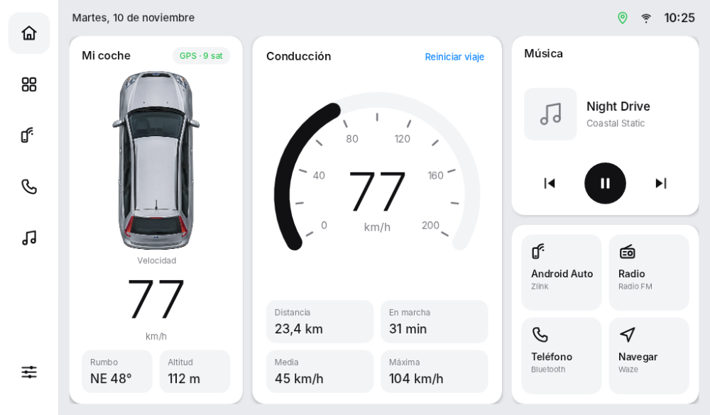<br><b>Inicio</b></td>
    <td align="center">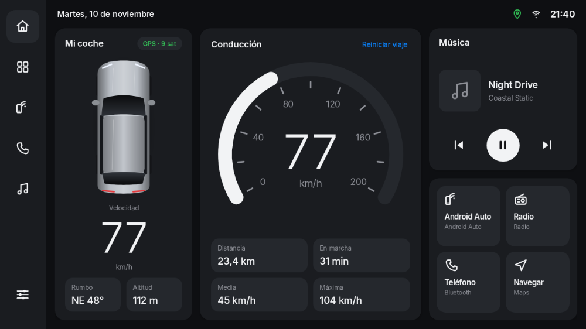<br><b>Modo oscuro</b> (automático al anochecer)</td>
  </tr>
  <tr>
    <td align="center">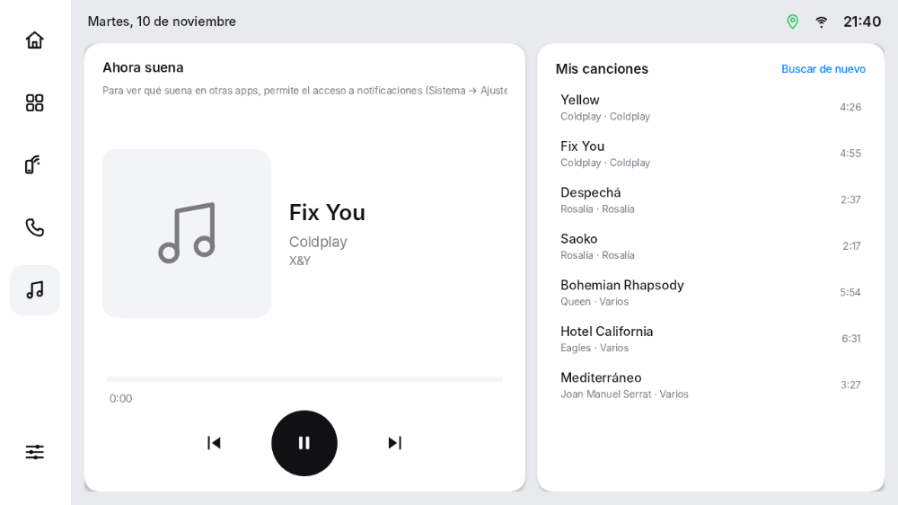<br><b>Música</b> de cualquier fuente</td>
    <td align="center">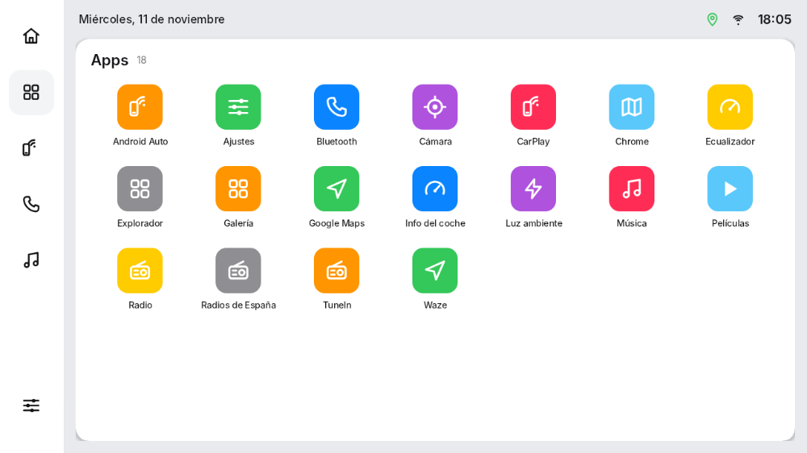<br><b>Apps</b></td>
  </tr>
  <tr>
    <td align="center">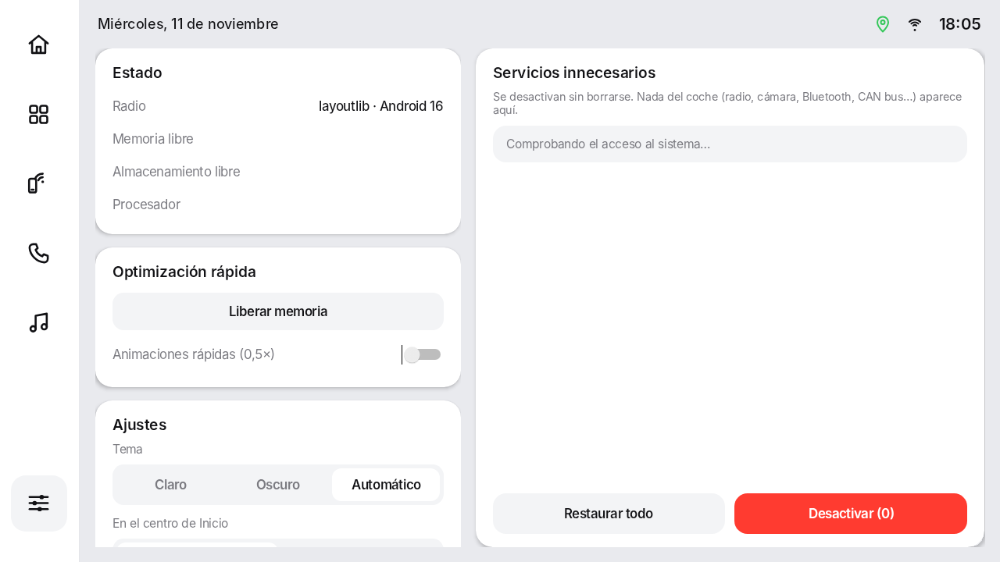<br><b>Sistema</b></td>
    <td align="center">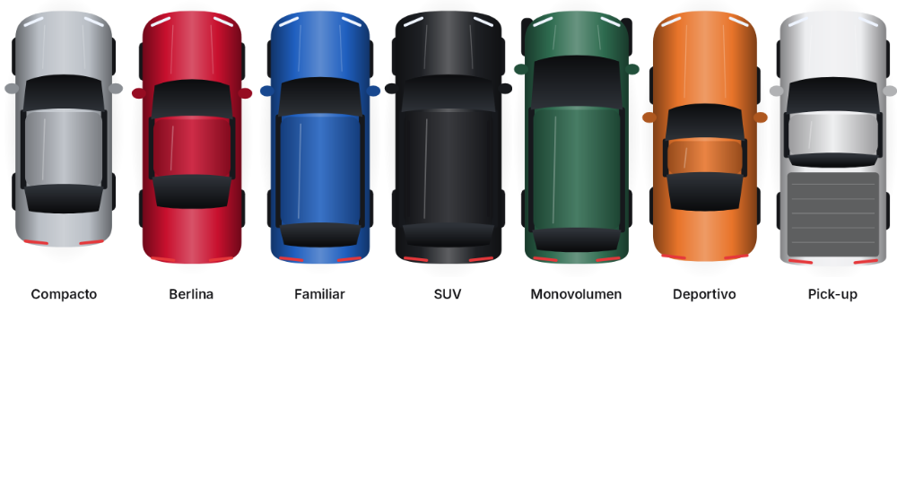<br><b>Constructor de coche</b></td>
  </tr>
</table>

<details>
<summary>Sistema completa, en modo oscuro (mapas, botones del volante y constructor)</summary>
<br>
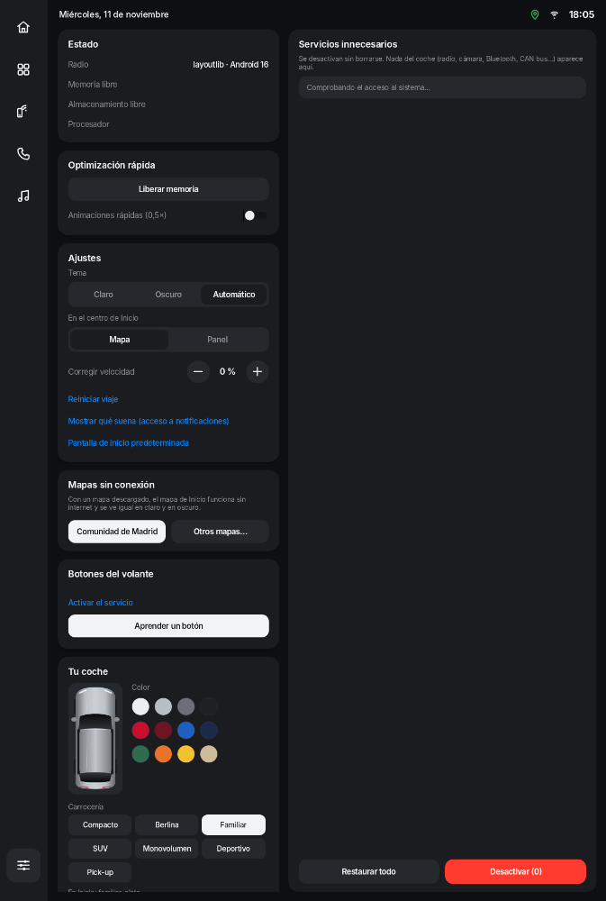
</details>

<sub>Son la interfaz real a 1280×720, dibujada en el ordenador con el motor de Android Studio y **datos de ejemplo**
(velocidad, canciones, apps): no son fotos de la radio. El mapa no aparece porque necesita sus archivos de mapa, y
en Sistema se lee "layoutlib" donde la radio pone su modelo.</sub>

### Qué hace

**Inicio**
- **Tu coche visto desde arriba** con la **velocidad por GPS** en grande, el rumbo y la altitud. La aguja, el número
  y el mapa se mueven de forma fluida: el GPS da un dato por segundo y EdgeOS calcula los fotogramas intermedios.
- **En el centro, a elegir:** el **mapa** (OpenStreetMap en gris, **sin internet** con los mapas descargados) con el
  botón *Navegar*; gira con el coche para que la calle por la que vas quede siempre arriba (con la brújula pasa a
  norte arriba). O un **panel de conducción** con velocímetro, distancia, tiempo en marcha, media y máxima.
- **Música** y **accesos rápidos**: Android Auto, Radio, Teléfono y Navegar. Cada uno encuentra solo la app de tu radio.

**Música**: una pantalla para **cualquier fuente** (Bluetooth del móvil, Spotify, TuneIn, Android Auto…), con
carátula, barra de progreso que se arrastra y selector de fuentes, más un **reproductor propio** para la memoria
interna y los USB que se pausa solo durante las llamadas.

**Presentación** al primer arranque: qué ofrece, los permisos con un botón y cómo dejarla como pantalla de inicio.

**Sistema**
- **Wi-Fi**: redes cercanas, conectar con contraseña y encender o apagar, sin salir del launcher.
- **Estado** de la radio: memoria, almacenamiento y temperatura del procesador.
- **Optimización**: liberar memoria, animaciones más rápidas y **servicios innecesarios** desactivables, como el
  actualizador Adups, que envía datos a China. **Nada del coche aparece nunca** (radio, cámara, Bluetooth, CAN bus,
  volante, audio, GPS) y *Restaurar todo* lo devuelve.
- **Tema**: claro, oscuro o automático (amanecer y atardecer según donde estés).
- **Mapas sin conexión**: la Comunidad de Madrid de un toque, o cualquier región del catálogo.
- **Botones del volante**: los que llegan a Android se aprenden (una acción al pulsar y otra al mantener); los que
  van por el microcontrolador de la radio se configuran en su herramienta de fábrica, enlazada desde aquí.
- **Tu coche**: siete carrocerías y doce colores, o una foto propia (con una guía para crearla con IA).

Todo en **pantalla completa**, sin la barra del sistema. Los detalles de cada función están en
[`car/README.md`](car/README.md).

### Radios compatibles

**Requisitos:** Android **8.0 o superior** y pantalla horizontal, de cualquier resolución (el diseño se escala;
revisado a 1024×600 y a 1280×720). Para la velocidad hace falta el GPS de la radio; internet es opcional.

| Radio | Estado |
|---|---|
| **k80_bsp de Reglink** (MediaTek MT6580, 1 GB, Android 8.1 aunque se anuncie como 12, 1280×720, firmware `CMENZX80-U1`) | ✅ **En uso.** Es la radio para la que se hizo, inspeccionada a fondo. |
| Otras radios **Reglink / "alps" con MT6580** | 🟡 Deberían funcionar igual (misma plataforma). Sin probar. |
| **FYT** (Joying, Atoto…), **MTCD/MTCE** (PX5/PX6), **TS10**, **Allwinner T3/T5** y otras genéricas con Android 8–13 | 🟡 El launcher debería funcionar. Botones del volante y radio FM dependen de cada fabricante. Sin probar. |
| Radios con Android 7 o anterior | ❌ No compatibles. |

Qué necesita cada función:

| Función | Funciona en |
|---|---|
| Inicio, velocidad, mapa, música, apps, tema, tu coche | Cualquier radio con Android 8+ |
| Servicios innecesarios y animaciones rápidas | Radios con **root** o con el **ADB por red** activo (la mayoría lo traen); sin instalar nada más |
| Botones del volante | Los que llegan a Android como teclas. En la k80_bsp van por el microcontrolador: se usa la herramienta de fábrica |
| Android Auto | Radios con app receptora: Zlink, AutoKit, Carlinkit, TLink o la propia (en la k80_bsp, `yellow.android.aasink`) |
| Radio FM y teléfono propios | En desarrollo, primero para la k80_bsp |

¿Tienes otra radio? El script [`tools/inspeccionar-radio.sh`](tools/inspeccionar-radio.sh) la estudia por ADB sin
cambiar nada; con su informe se puede adaptar EdgeOS Car a ella.

### Instalar EdgeOS Car

**Con Claude Code (lo fácil).** En una terminal:
```bash
git clone https://github.com/Smith-Develop/EdgeOS.git
cd EdgeOS
claude
```
y dile: *"Instala EdgeOS Car en mi radio Android, está en 192.168.1.50. Ve diciéndome lo que necesites de mí."*
Instala lo que falte en el ordenador, compila, instala en la radio y solo te pide lo que se hace con la radio
delante. Sigue [`CLAUDE.md`](CLAUDE.md).

**A mano.** `./gradlew :car:assembleDebug`, copia `car/build/outputs/apk/debug/car-debug.apk` a la radio (memoria
USB o `adb install -r`), ábrelo, acepta el permiso de ubicación y elige **EdgeOS Car** como pantalla de inicio. No
desactives el launcher de fábrica: así siempre puedes volver a él. Los detalles están en [`car/README.md`](car/README.md).

### Cómo se construyó

EdgeOS Car se hizo **en conversación con [Claude Code](https://claude.com/claude-code)**: el propietario de la
radio decidía qué quería y hacía las pruebas con la radio delante, y Claude escribía el código, lo compilaba y lo
revisaba.

1. **Punto de partida.** La idea viene de [Free My TV](https://github.com/simbasjungles/free-my-tv), que hace lo
   mismo con los televisores: un inicio limpio y apps de fábrica desactivadas sin root. Su cliente ADB (MIT) es la
   base de cómo EdgeOS Car consigue permisos de sistema.
2. **Diseño.** Se partió de dos referencias de salpicaderos (tarjetas claras, coche visto desde arriba, mapa) y se
   llevó a una cuadrícula de 1024×600 que se escala a cualquier pantalla.
3. **Estudiar la radio antes de programar.** `tools/inspeccionar-radio.sh` sacó por ADB todo lo necesario: la
   pantalla real (1280×720), Android 8.1 de verdad, la plataforma Reglink, que la radio FM usa el chip del MT6580 a
   través de la app `mtkradio`, que los botones del volante no llegan a Android y que no hay caja CAN instalada.
   Cada decisión de abajo sale de ese informe.
4. **Iterar con la radio.** Cada versión se probó en el coche y se corrigió lo que fallaba: el coche que salía en
   blanco, la velocidad a saltos, la barra del sistema que se veía arriba…

**Decisiones técnicas**
- **Vistas clásicas de Android, sin Compose ni AndroidX:** la radio tiene una GPU Mali-400 y 1 GB de RAM, y así va
  más ligera. El APK ocupa unos 3 MB.
- **Fluidez:** valores animados fotograma a fotograma con `Choreographer` (`ui/Tween.kt`), y animaciones que se
  paran cuando no se ven, para no gastar procesador con otra app delante.
- **Permisos sin apps externas:** root si lo hay; si no, un cliente ADB propio que se conecta a la propia radio en
  `127.0.0.1:5555` (`system/LocalAdb.kt`). Solo se desactiva con `pm disable-user`, nunca se desinstala.
- **Coche dibujado, no foto:** las carrocerías son trazados con degradados (`ui/CarArt.kt`). En esta GPU, las
  imágenes grandes dentro de tarjetas recortadas podían no pintarse.
- **Mapas vectoriales** de Mapsforge con datos de OpenStreetMap, dibujados en la propia radio: funcionan sin
  internet y siguen el modo oscuro.
- **Una sola sesión multimedia por fuente:** la música de cualquier app se lee y se controla con las sesiones
  multimedia de Android; el reproductor propio publica la suya, para que lo controlen los botones del volante.

**Cómo se comprueba**
- Compila con AGP 9.3 y Kotlin 2.4 (`compileSdk 37`, `minSdk 26`, `targetSdk 36`).
- La interfaz se revisa sin radio, dibujándola a 1024×600 y 1280×720 con
  [Paparazzi](https://github.com/cashapp/paparazzi) (el motor de vista previa de Android Studio): así salen las
  capturas de arriba, y así apareció un fallo que cerraba la app al arrancar antes de que llegara a la radio.
- Pruebas unitarias del lector del catálogo de mapas (`./gradlew :car:testDebugUnitTest`).
- Lo que no se puede ver en el ordenador (GPS, sesiones multimedia, ADB) se prueba en la radio, y la app deja
  diagnóstico en `adb logcat -s EdgeOSCar`.

**Próximos pasos:** radio FM propia (dial, emisoras y RDS), teléfono por Bluetooth, y datos del coche (puertas,
luces, gasolina) con una caja CAN o un adaptador OBD2, con un modo para "enseñarle" a reconocerlos.

---

## Vidrio: el móvil

Un launcher con aspecto de iOS 26 ("Liquid Glass") que además limpia las apps de fábrica, sin root y sin PC.
Pensado para el **Motorola Edge 70 con Android 16**; funciona en cualquier Android 13 o superior.

> [!IMPORTANT]
> **Versión 0.1: compila, pero aún no se ha probado en un teléfono.** Las imágenes son **maquetas del diseño**,
> no capturas reales.

- **Inicio estilo iPhone**: cuadrícula de 4 columnas por páginas, puntos de página, botón **Buscar** sobre el
  dock e iconos en cuadrado redondeado.
- **Dock de vidrio** con hasta 4 apps; la primera vez pone teléfono, mensajes, navegador y cámara.
- **Búsqueda** sin distinguir tildes ni mayúsculas.
- **Mantener pulsada una app**: dock, información, desinstalar. **Mantener pulsado el fondo**: fondo de pantalla,
  Limpieza, hacer de Vidrio el inicio.
- **Limpieza** con [Shizuku](https://shizuku.rikka.app/): desactiva las apps que
  [UAD-ng](https://github.com/Universal-Debloater-Alliance/universal-android-debloater-next-generation) marca como
  seguras de quitar. **No borra nada** y *Restaurar todo* las vuelve a activar.

El vidrio es [Kyant0/AndroidLiquidGlass](https://github.com/Kyant0/AndroidLiquidGlass): desenfoque, refracción y
viveza de color en tiempo real.

<table>
  <tr>
    <td align="center">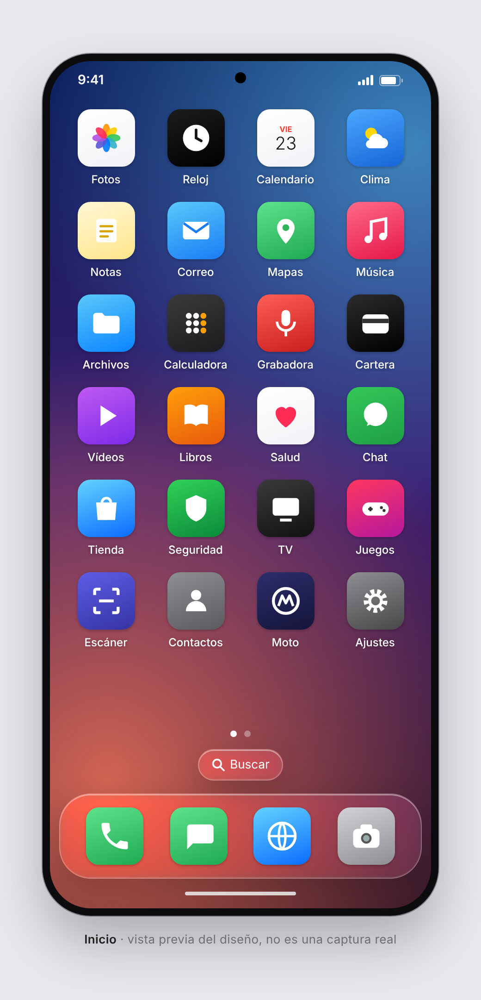<br><b>Inicio</b></td>
    <td align="center">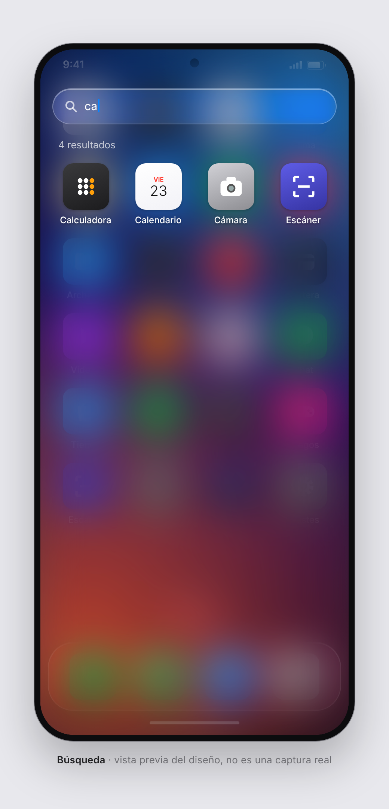<br><b>Búsqueda</b></td>
    <td align="center">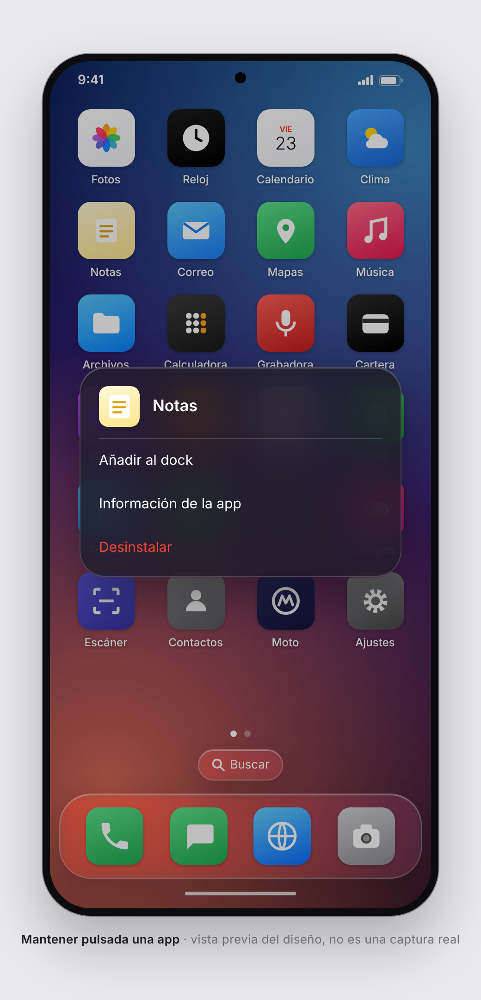<br><b>Menú de una app</b></td>
  </tr>
  <tr>
    <td align="center">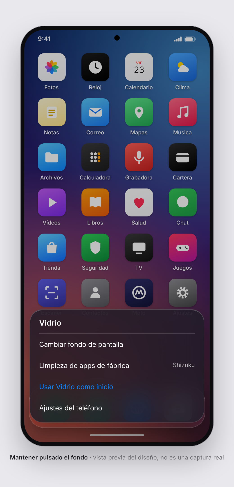<br><b>Ajustes</b></td>
    <td align="center">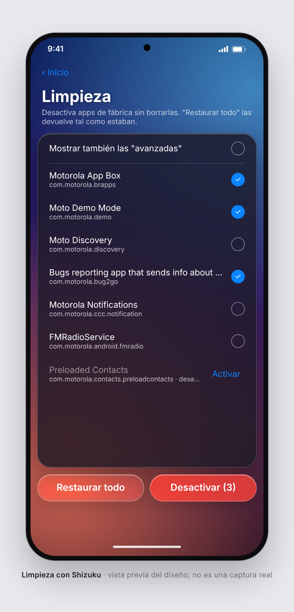<br><b>Limpieza</b></td>
    <td></td>
  </tr>
</table>

**Instalar:** con Claude Code, dile *"Instala EdgeOS en mi Moto Edge 70. Ve diciéndome lo que necesites de mí."*
A mano, la guía paso a paso está en [`docs/INSTALACION.md`](docs/INSTALACION.md).

**Volver atrás:** Limpieza → *Restaurar todo*, y en Ajustes → Apps → Apps predeterminadas → App de inicio, el
launcher de Motorola. Vidrio nunca ofrece desactivar launchers, Ajustes, la interfaz del sistema ni Shizuku.

**Cómo está hecho:** Kotlin + Jetpack Compose, AGP 9.3, Kotlin 2.4, `compileSdk 37`, `minSdk 33`, `targetSdk 36`.
El fondo lo dibuja el propio launcher: Android 13+ no deja que una app normal lea el del sistema.

---

## Licencias

- Código de EdgeOS (Car y Vidrio): aún sin licencia elegida.
- [osmdroid](https://github.com/osmdroid/osmdroid): Apache 2.0. [Mapsforge](https://github.com/mapsforge/mapsforge):
  LGPL-3.0. Datos de mapa © colaboradores de [OpenStreetMap](https://www.openstreetmap.org/copyright), ODbL.
- Cliente ADB de EdgeOS Car adaptado de [Free My TV](https://github.com/simbasjungles/free-my-tv) (MIT).
- [AndroidLiquidGlass](https://github.com/Kyant0/AndroidLiquidGlass) (`backdrop`, `shapes`): Apache 2.0.
  [Shizuku API](https://github.com/RikkaApps/Shizuku-API): Apache 2.0.
- La lista de UAD-ng es **GPL-3**: se **descarga** al usarla y no va dentro de los APK.
- Fuente Inter: SIL Open Font License ([`LICENSE-Inter-OFL.txt`](LICENSE-Inter-OFL.txt)).
- No se usa ningún recurso de Apple ni de fabricantes de coches.
