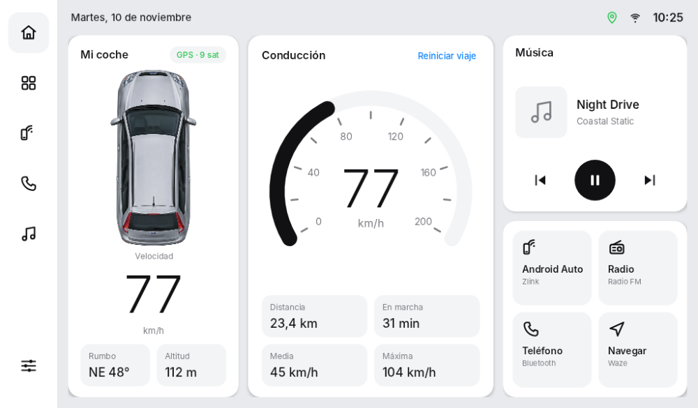
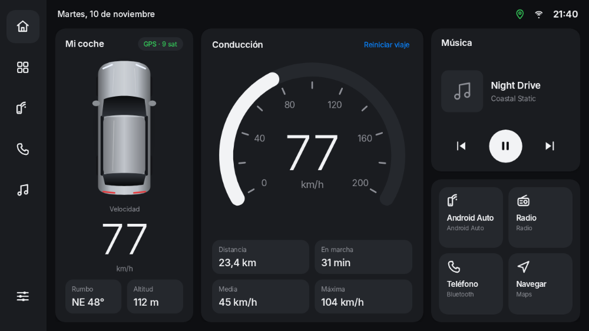
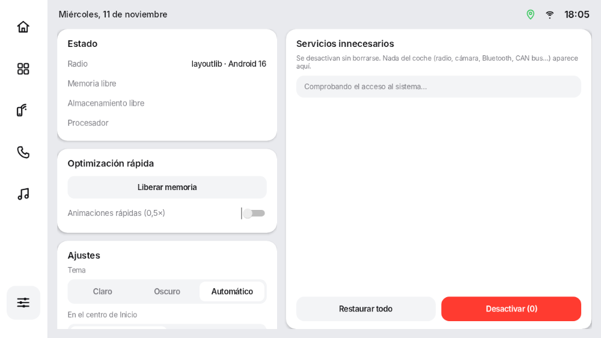
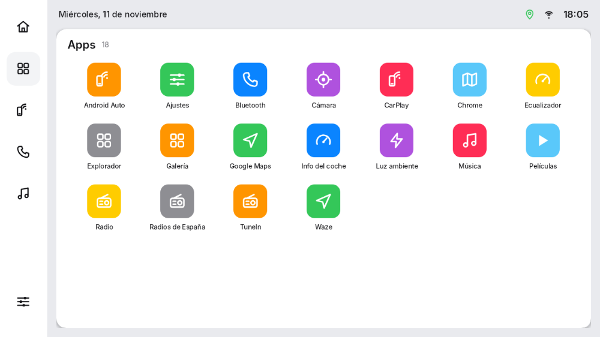
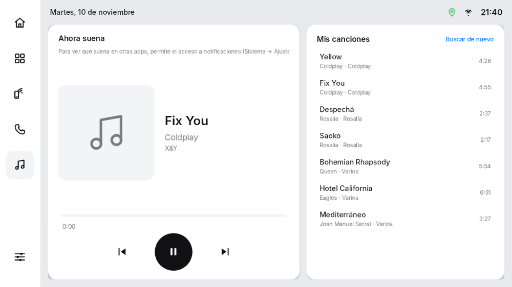
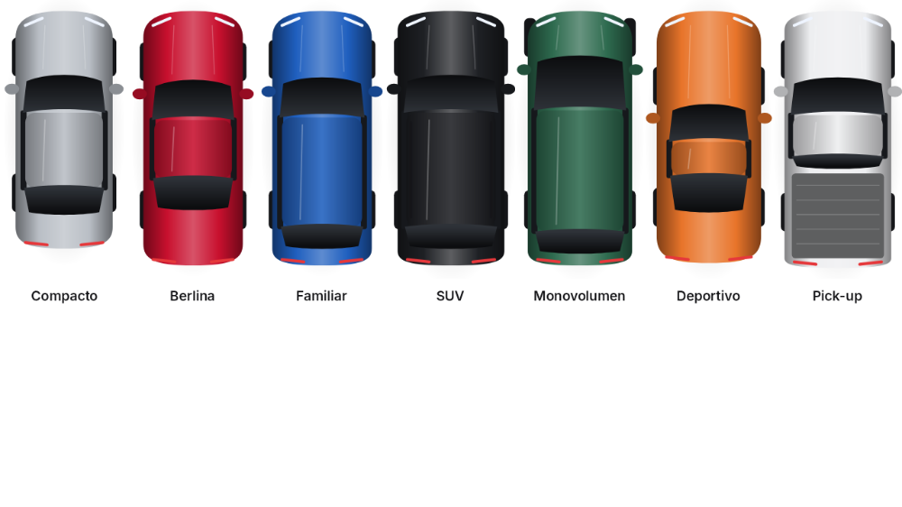

# EdgeOS Car

Un launcher para **radios Android de coche**, limpio y claro, al estilo de los salpicaderos de gama alta: el coche
visto desde arriba con la velocidad, el mapa o un panel de conducción, la música y los accesos rápidos. Incluye
**Sistema**, una pantalla para optimizar la radio y desactivar servicios que no hacen falta, sin root y con
vuelta atrás.

Pensado para la **k80_bsp** (MediaTek MT6580, Android 8.1, 1024×600) y radios parecidas. Funciona desde Android 8.0.

> [!NOTE]
> **Versión 0.1, compilada pero sin probar en una radio.** El APK se genera sin errores y la interfaz se ha
> revisado en el ordenador (las capturas de abajo), pero todavía no ha funcionado en ningún aparato real.

<table>
  <tr>
    <td align="center"> <b>Inicio</b> (modo Panel)</td>
    <td align="center"> <b>Modo oscuro</b></td>
  </tr>
  <tr>
    <td align="center"> <b>Sistema</b></td>
  </tr>
  <tr>
    <td align="center"> <b>Apps</b></td>
    <td></td>
  </tr>
</table>

Capturas de la interfaz real, dibujada con el motor de Android Studio a 1024×600 y con datos de ejemplo
(velocidad, canción, apps). No vienen de una radio: el mapa no aparece porque necesita internet, y la pantalla
Sistema muestra "layoutlib" en vez del modelo y deja la memoria en blanco, cosas que en la radio salen bien.

## Qué tiene

**Inicio**
- **Mi coche**: tu coche visto desde arriba, la **velocidad por GPS** en grande, el rumbo y la altitud. Lo eliges
  en Sistema → *Tu coche*: carrocería y color, o una foto propia (ver abajo).
- **Modo oscuro** para todo, mapa incluido: *Claro*, *Oscuro* o *Automático* (cambia solo al amanecer y al
  atardecer de donde estés), en Sistema → Ajustes → Tema.
- **En el centro, a elegir** en Sistema → Ajustes:
  - **Mapa** de OpenStreetMap en gris claro (u oscuro), con tu posición, zoom, recentrar y el botón **Navegar** (abre
    Google Maps, Waze u otra). **Sin internet** con los mapas descargados (ver abajo); sin ellos, va por internet.
  - **Panel** de conducción, sin internet: velocímetro de aguja, distancia, tiempo en marcha, media y máxima.
- **Música**: carátula, título y artista de lo que suena, con anterior, reproducir/pausa y siguiente. Al tocarla se
  abre la pantalla **Música** (ver abajo).
- **Android Auto**: un botón en la barra lateral y un acceso rápido que abren la app de proyección de la radio
  (Zlink, AutoKit, Carlinkit, TLink…), que es la que muestra Android Auto y CarPlay. Si no la encuentra sola, te
  deja elegirla.
- **Accesos rápidos**: Android Auto, Radio, Teléfono y Navegar. Cada uno busca solo la app adecuada de tu radio;
  mantenlo pulsado para elegir otra.

**Música** (botón de la barra lateral, o tocar la tarjeta de Inicio): una sola pantalla para **cualquier fuente**,
sin abrir la app de cada una.
- **Ahora suena**: carátula grande, título, artista y álbum, barra de progreso fluida (se arrastra para saltar si
  la fuente lo permite) y controles. Arriba, las **fuentes** activas (Bluetooth del móvil, Spotify, TuneIn, Radios de
  España, Android Auto…): toca una para controlarla; *Abrir la app* lleva a la suya.
- **Mis canciones**: reproductor propio para la música de la radio y de las **memorias USB** (MP3, M4A, FLAC, OGG,
  WAV…), con carátulas. Se controla también con los botones del volante y el Bluetooth del coche, y se pausa solo
  durante las llamadas y los avisos del navegador.

**Apps**: todas las apps de la radio. Mantener pulsada una: información o usarla para un acceso rápido.

**Sistema**
- **Estado**: modelo, Android, memoria y almacenamiento libres, temperatura del procesador.
- **Optimización rápida**: *Liberar memoria* (cierra lo que está en segundo plano, menos lo que suena, la radio y
  lo del coche) y *Animaciones rápidas* a 0,5×.
- **Ajustes**: mapa o panel, corrección de la velocidad (±15 %), reiniciar el viaje, permitir ver qué suena y
  elegir la pantalla de inicio.
- **Servicios innecesarios**: desactiva con `pm disable-user` actualizadores que envían datos a China (Adups FOTA),
  registros de depuración, fondos animados, impresión y apps de serie que nadie usa en un coche, más las
  *Recommended* de [UAD-ng](https://github.com/Universal-Debloater-Alliance/universal-android-debloater-next-generation).
  **Nada que suene a coche aparece nunca**: radio, cámara de marcha atrás, Bluetooth, CAN bus, MCU, mandos del
  volante, audio, GPS, CarPlay/Android Auto… Tampoco los launchers ni Ajustes. **Restaurar todo** lo devuelve.

## Instalar

### Con Claude Code (lo fácil)

En la carpeta del repo, ejecuta `claude` y dile:

> Instala EdgeOS Car en mi radio Android k80_bsp. Ve diciéndome lo que necesites de mí.

Sigue las instrucciones de [`CLAUDE.md`](../CLAUDE.md#edgeos-car-la-radio-del-coche).

### A mano

1. Compila: `./gradlew :car:assembleDebug` → `car/build/outputs/apk/debug/car-debug.apk`.
2. Pásalo a la radio con una memoria USB y ábrelo, o con la depuración USB activa: `adb install -r car-debug.apk`.
3. Ábrelo, **acepta el permiso de ubicación** (sin él no hay velocidad) y pulsa Inicio → **EdgeOS Car** → *Siempre*.

⚠️ **No desactives el launcher de fábrica.** En esta placa hay casos de radio FM que deja de funcionar sin él.
EdgeOS Car nunca lo ofrece en Servicios innecesarios.

### Para Servicios innecesarios y Animaciones rápidas: sin instalar nada más

Android 8 no deja que una app desactive otras. EdgeOS Car lo hace solo, de dos maneras:

1. **Con root**, si la radio lo tiene (muchas lo traen): lo usa directamente.
2. **Con el ADB de la propia radio**: EdgeOS Car lleva dentro un cliente ADB que se conecta a la radio por la
   red interna (`127.0.0.1:5555`). Activa *Ajustes → Opciones de desarrollador → Depuración USB*; la primera vez
   la radio pregunta **¿Permitir depuración USB?**: marca *Permitir siempre* y acepta.

Si la radio no tiene el ADB por red abierto (el puerto 5555), se abre una vez desde un ordenador con la radio
conectada por USB: `adb tcpip 5555`. En muchas radios hay que repetirlo tras cada arranque. Lo que ya desactivaste
sigue desactivado aunque el ADB esté cerrado.

### Tu coche

Sistema → **Tu coche**: elige la **carrocería** (compacto, berlina, familiar, SUV, monovolumen, deportivo o pick-up)
y el **color**, y se ve al momento en Inicio.

¿Prefieres una foto? *Usar una foto…* (o tocar el coche en Inicio) muestra las imágenes de la radio y de las
memorias USB, con miniatura; *Volver al dibujo* deshace. Para crearla con IA (ChatGPT, Gemini, Copilot…), pide algo así:

> Vista cenital exacta, desde arriba, de un [marca, modelo y color de tu coche], con el morro hacia arriba,
> centrado y recto, sin perspectiva. Fondo blanco liso o transparente, sin sombras ni texto. Imagen vertical de
> 600 × 1200 píxeles; el coche ocupa casi todo el alto.

- **Medidas:** vertical, proporción 1:2 (600 × 1200 px es ideal). PNG con fondo transparente o blanco.
- **Pasarla a la radio:** cópiala a una memoria USB (en la raíz, en Download o en Pictures), conéctala y elígela de
  la lista. La primera vez pide permiso de almacenamiento.
- Se copia dentro de la app: después puedes quitar la memoria USB.

### Mapas sin conexión

Sistema → **Mapas sin conexión**:
- **Comunidad de Madrid**: un toque. Si el servidor no la tiene por separado, ofrece España entera, indicando
  cuánto ocupa y cuánto espacio libre queda.
- **Otros mapas…**: recorre el catálogo (continente → país → región) y baja los que quieras.
- Se bajan con el gestor de descargas de Android (sigue aunque cambies de pantalla; mejor con Wi-Fi). Al terminar, el
  mapa de Inicio pasa a dibujarse **en la radio, sin internet**. Cada mapa se puede borrar.

Son mapas vectoriales de [Mapsforge](https://github.com/mapsforge/mapsforge) con datos de
[OpenStreetMap](https://www.openstreetmap.org/copyright) (© colaboradores de OpenStreetMap, ODbL), del servidor
`download.mapsforge.org`. La radio consulta su catálogo, así que se adapta a las regiones que haya.

## Volver atrás

- Sistema → **Restaurar todo**. Sin EdgeOS Car: `adb shell pm enable <paquete>`.
- Launcher de fábrica: Ajustes → Apps → App de inicio, o mantén pulsado Inicio y elígelo.

## Limitaciones conocidas

- Android Auto se ve a pantalla completa en su propia app (Zlink, AutoKit…): Android 8 no permite meter otra app
  dentro de una tarjeta del launcher.
- La velocidad, el viaje y el mapa se actualizan mientras EdgeOS Car está a la vista. Con otra app delante,
  Android 8 limita el GPS en segundo plano, así que ese tramo no cuenta en el viaje.
- Sin acceso a notificaciones, la tarjeta de música no sabe qué suena (los botones sí funcionan).
- Climatización, puertas o presión de neumáticos dependen del CAN bus de cada radio y no están.

## Cómo está hecho

Va a **pantalla completa**: sin barra de estado ni de navegación (deslizando desde el borde aparecen un momento).

Kotlin con vistas clásicas de Android, sin Compose ni AndroidX: en un Mali-400 cada milisegundo cuenta. Todo se
diseña sobre 1024×600 y se escala a la pantalla real (`ui/Ui.kt`).

| Archivo | Qué hace |
|---|---|
| `HomeActivity.kt` | La pantalla de inicio: barra lateral, barra superior y las tres páginas. |
| `drive/Drive.kt` | Velocidad (Doppler del GPS o distancia entre posiciones), rumbo, altitud y viaje. |
| `drive/Media.kt` | Lo que suena y sus controles. |
| `Apps.kt` | Apps instaladas y la app de cada acceso rápido. |
| `system/Optimizer.kt` | Servicios innecesarios, filtro de lo del coche, memoria, animaciones. |
| `system/Shell.kt`, `system/LocalAdb.kt` | Acceso al sistema: root o el ADB de la propia radio (cliente adaptado de Free My TV, MIT). |
| `ui/Tween.kt` | Lleva velocidad, aguja y mapa al nuevo dato fotograma a fotograma: el GPS da uno por segundo. |
| `CarImage.kt` | La imagen del coche: la de serie o la del usuario, copiada a la memoria de la app. |
| `maps/Maps.kt`, `ui/MapsUi.kt` | Mapas sin conexión: catálogo, descargas y diálogos. |
| `music/` | Biblioteca de canciones y reproductor propio. |
| `ui/` | Tarjetas, mapa, iconos y páginas. |
